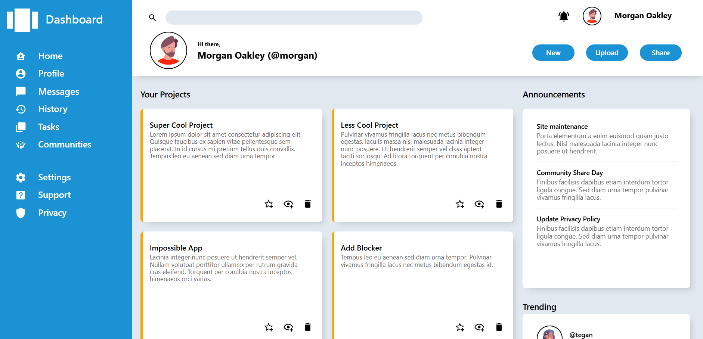

# Admin Dashboard
This is one more of the The Odin Project [projects](https://www.theodinproject.com/lessons/node-path-intermediate-html-and-css-admin-dashboard). I have built a basic dashboard using mainly grid. Note that I used flex for svgs inside of the projects container and inside trending and announcement container, because it was much easier to do that way.
## What I used
- HTML5
- CSS3
## What I learned
- Learned how to use grid
- When to use grid and when is better to use flex
- Flexible measurement like fr to make my layout a bit more responsive
## Preview

## Sources
- https://loremipsum.io/generator/?n=100&t=s (lorem ipsum generator)
- https://pictogrammers.com/library/mdi/
- https://www.svgrepo.com/vectors/avatar/
## Live demo
[Click here](https://dixon3o.github.io/admin-dashboard/)